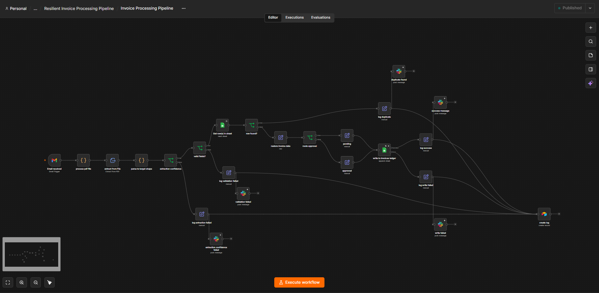
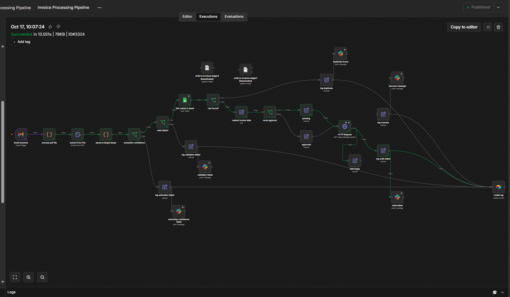
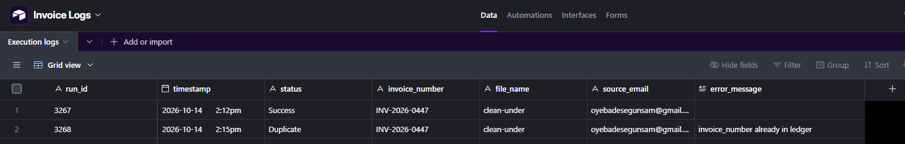

# Resilient Invoice Processing Pipeline — case-study.md

**Stack:** n8n, Gmail, Google Sheets, Airtable, Slack | **Status:** Production-tested

## The Problem

Vendor invoices arrive as email attachments and someone has to open each one, type the details
into a ledger, and decide whether it needs approval. It's slow, easy to get wrong, and a missed
or half-entered invoice means a late payment nobody noticed. The goal of this workflow is a pipeline
that survives bad input and flaky services without losing an invoice or failing silently.

## The Solution

A Gmail trigger watches the `Invoices` label. Each PDF attachment is split into its own item,
read with n8n's PDF text extraction, and parsed into five fields (invoice number, vendor, dates,
amount). Two separate gates follow: one checks whether enough data was read(extraction confidence),
the other checks whether what was read is usable. Valid invoices are checked against the ledger for duplicates, then
routed by amount: over or equal $1,000 is marked Pending Approval, anything else is Auto-Approved.
The row is written to a Google Sheets ledger with retries. Every outcome, success or failure,
writes one row to an Execution Log in Airtable and sends a Slack message that says what
happened and what a human should do.

## Key Design Decisions

- **Every exit path ends in the same log write.** Five outcomes (success, extraction failed,
  validation failed, duplicate, write failed) each get a small Set node that stamps a status and
  error, then all of them feed one Airtable log node. One place to look, no branch that can end
  without a record.
- **The log lives in Airtable, not Google Sheets.** The ledger is in Sheets. If Sheets is the
  thing that's down, a log in the same place goes down with it. A different provider means the
  failure still gets recorded.
- **Two gates, not one.** The extraction gate asks "did we read enough?" (confidence is the
  fraction of 5 fields found, 0.7 minimum, so 4 of 5). The validation gate asks "is what we read
  usable?" A PDF can score 4 of 5 while the missing field is the amount, which only the second
  gate catches. Keeping them separate also makes the log say which kind of failure it was.
- **Duplicate check by invoice number, against the ledger.** A failed write never reaches the
  ledger, so it doesn't block reprocessing the same invoice later.
- **Pending Approval needs a human.** Nothing auto-approves on a timer. An invoice of exactly
  $999 is auto-approved because the rule is strictly "over or equal $1,000".
- **Retries use n8n's built-in Retry On Fail** 3 tries, 5 second wait.
- **A global error workflow sits underneath everything.** The explicit branches handle failures
  I could predict. The Error Trigger workflow catches the rest, including the log write itself
  failing.
- **OCR was scoped out on purpose.** Scanned or photographed invoices come out as empty text.
  I looked at adding an OCR API and decided it was a stretch for v1. This version expects
  text-based PDFs in a defined layout, and OCR is the planned v2 if a client needs it.

## Reliability & Edge Cases Handled

- **Email with no PDF, or a non-invoice attachment** Filtered out at the email stage, never touches the workflow.
- **Unreadable or garbage PDF** Extraction Failed, logged, Slack tells someone it needs manual
  entry.
- **PDF with a missing or unusable field** (e.g. no amount) passes extraction, fails validation,
  logged with the exact missing field names.
- **Same invoice sent twice** second one logs as Duplicate and isn't written again.
- **Ledger write failing, two different ways, tested separately:**

    | Failure                                                  | What happened                                                   |
    | -------------------------------------------------------- | --------------------------------------------------------------- |
    | Service unreachable (dead endpoint)                      | 3 attempts, about 14.6s, then Write Failed                      |
    | Configuration error (nonexistent document or sheet name) | Failed immediately, no retries, 2s -4s total, then Write Failed |

    Both end in the same Write Failed log row and urgent Slack message. Failing fast on something
    that can't succeed is the right behavior. This is what I observed on the Google Sheets node
    (v4.7).

- **Log write itself failing** tested by pointing the Airtable node at a wrong table. The global
  error workflow posted to `#automation-alerts` slack channel naming the failed node.

## What Went Wrong Along the Way

- **Only one of five exit paths wrote to the log.** I'd wired the log node to Write Failed and
  stopped. Successful runs left no record, so the "log rows = invoices processed" check couldn't
  work. Caught in review, fixed by wiring all five paths in.
- **My test PDFs all shared one invoice number,** so the duplicate check correctly swallowed
  every one after the first. Gave each test file its own number.
- **A Set node can't read a field it's setting in the same pass.** The validation Slack message
  referenced `log_error` in the same node that defined it, so it came out blank. Moved the
  message into the Slack node, which receives the finished item.
- **The Gmail trigger confused me in testing.** In the editor it fetches one email, the newest,
  every time, which made it look like the second email was being ignored. In production it only
  picks up new arrivals, and its default is unread emails only. Set it to unread and read so
  opening an email can't cause a miss.

## Known Limitations

- Scanned or photographed invoices aren't supported (OCR planned for v2).
- Parsing expects a defined invoice layout. A different layout will score low on confidence and
  exit as Extraction Failed.
- Retry wait is fixed at 5 seconds, not exponential.

## Outcome / Impact

- Invoices go from email to ledger with no manual typing. Typical runs finished in 2.6 to 4.3
  seconds.
- No silent failures across the test suite. Every path, including success, leaves a log row on Airtable
  and a Slack message.
- Large invoices can't slip through unreviewed: everything over or equal $1,000 waits for a human.

## Tech Stack

`n8n` `Gmail` `Google Sheets` `Airtable` `Slack`
`Node types used: Gmail Trigger, Code, Extract From File, IF, Edit Fields, Google Sheets
(Get/Append), Airtable (Create), Slack, Error Trigger`

## Screenshots / Evidence

- 
- 
- 
- 
